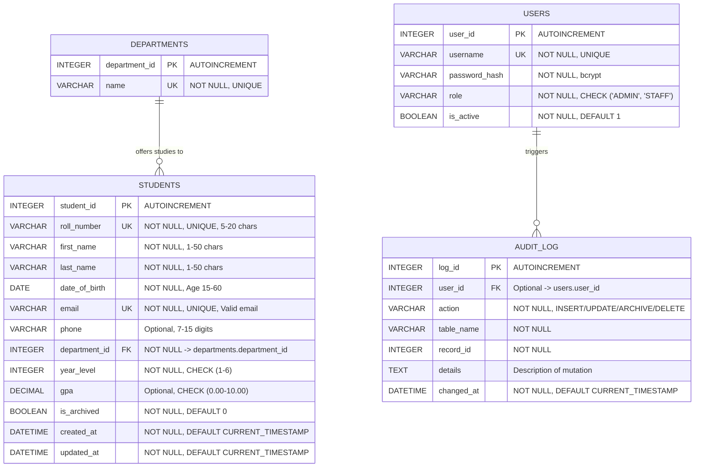

# Database Entity-Relationship (ER) Specification

## Conceptual Model

The database design provides a 3rd Normal Form (3NF) relational architecture ensuring ACID compliance, strict referential integrity, and query performance through index coverage.

## Performance Indexes

The following targeted indexes ensure sub-millisecond retrieval on large datasets:

| Index Name | Target Table | Indexed Columns | Justification |
|---|---|---|---|
| `idx_students_name` | `students` | `(last_name, first_name)` | Accelerates name sorting and prefix searches |
| `idx_students_department` | `students` | `department_id` | Optimizes foreign key joins with departments |
| `idx_students_year` | `students` | `year_level` | Speeds up year-level cohort filtering |
| `idx_students_archived` | `students` | `is_archived` | Drastically optimizes filtering active vs archived records |
| `idx_audit_record` | `audit_log` | `(table_name, record_id)` | Enables instantaneous historical audit lookups |

## Data Integrity Guarantees

1. **Foreign Key Enforcement:** SQLite `PRAGMA foreign_keys = ON;` is enforced at the connection layer.
2. **Optimistic Locking:** The `updated_at` timestamp prevents concurrent edit collisions across multi-user environments.
3. **Atomic Operations:** All multi-step write processes (student creation, bulk import, archiving) are wrapped inside transactional blocks with automatic rollback on error.
